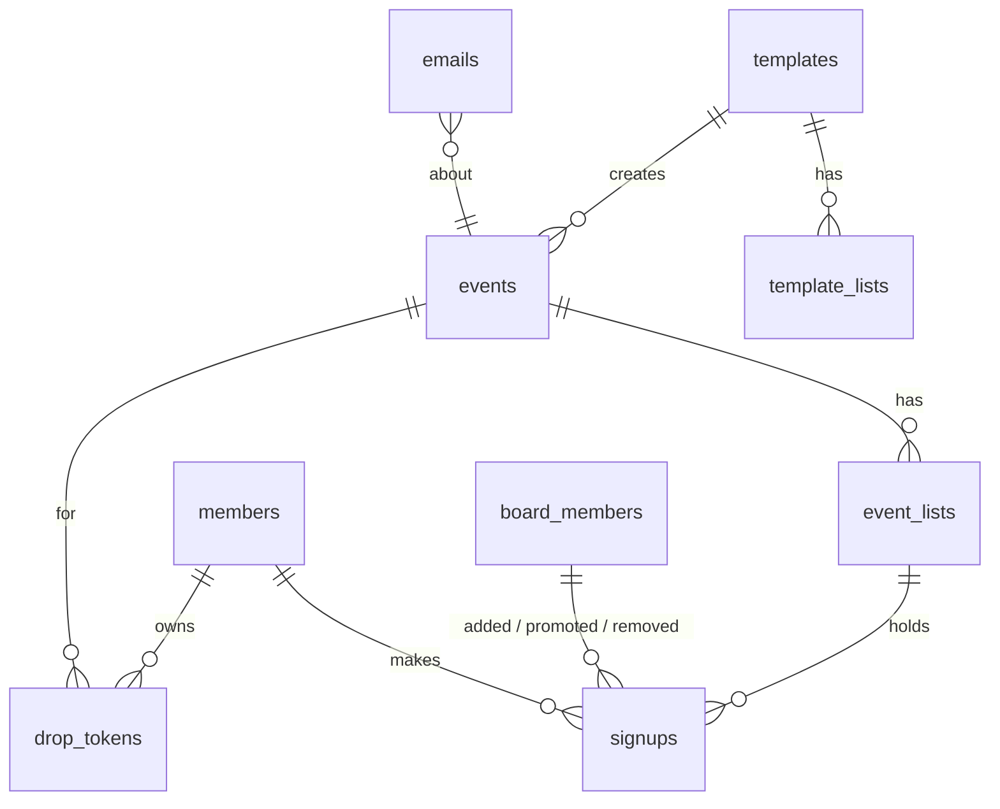

# CBS FC · The List: Data Model

_Last updated 2026-10-08. Postgres on Supabase. See [PLAN.md](PLAN.md) for requirements and [SCREENS.md](SCREENS.md) for screens._

## Overview

| Table | What it is | UI name |
|---|---|---|
| `templates` + `template_lists` | A recurring practice and its lists | Weekly schedule |
| `events` + `event_lists` | One dated practice and its lists (copied from the template, then editable) | Practice |
| `members` | A person, matched by email | — |
| `signups` | One person's spot on one list: main or waitlist, plus team | The list |
| `drop_tokens` | Secret behind each personal drop-out link | — |
| `board_members` | Who can log in to `/admin`, and their role | Board |
| `emails` | Outbox + log of every notification | — |

Everything is generic "events" with `type = 'practice'` for now, so games and socials can be added later without a redesign.

---

## Tables

### `board_members`
| Column | Type | Notes |
|---|---|---|
| id | uuid pk | |
| email | citext unique not null | Login is matched on this |
| user_id | uuid unique null → `auth.users` | Filled on first login |
| name | text | |
| role | enum `president` \| `board` | |
| invited_by | uuid null → board_members | |
| created_at | timestamptz | |

- Removing someone deletes the row. History columns elsewhere use `on delete set null`.
- **A trigger blocks deleting or demoting the last president.**

### `templates` (Weekly schedule)
| Column | Type | Notes |
|---|---|---|
| id | uuid pk | |
| type | enum `practice` | Room for `game`, `social` later |
| title | text | "Wednesday practice" |
| weekday | smallint 0–6 | |
| start_time, end_time | time | New York local time |
| location | text | |
| open_mode | enum `auto` \| `manual` | |
| open_days_before | smallint default 1 | Auto mode: "the day before" |
| open_time | time default 09:00 | Auto mode, New York local |
| paused | boolean default false | No new events while paused |

### `template_lists`
`id`, `template_id`, `name` ("Skills"), `cap` (int, default 40), `makes_teams` (bool), `position` (display order).

### `events` (one practice)
| Column | Type | Notes |
|---|---|---|
| id | uuid pk | |
| template_id | uuid null → templates | Null for one-offs later |
| type, title, location | | Copied from the template |
| slug | text unique | `2026-10-08-wed`, used in URLs |
| starts_at, ends_at | timestamptz | Stored in UTC |
| opens_at | timestamptz **null** | Null = manual and not opened yet. "Open sign-ups" sets it to `now()` |
| locks_at | timestamptz, **generated** = `starts_at − 2h` | |
| edited_at | timestamptz null | Set when the board edits this practice. Template changes then skip it |
| cancelled_at, cancel_reason, cancelled_by | | |

- `unique (template_id, starts_at)` lets the daily cron run any number of times without creating duplicates.
- **Saving a template** updates future events from it that haven't opened and haven't been edited individually.

### `event_lists`
`id`, `event_id`, `name`, `cap`, `makes_teams`, `position`, `teams_sent_at` (null until **Send teams**).

### `members`
| Column | Type | Notes |
|---|---|---|
| id | uuid pk | |
| email | citext **unique, null** | Null only for walk-ins added without one |
| name | text | **Latest wins**: every sign-up updates it |
| phone | text null | E.164 (`+12125550148`), checked with a constraint. Latest wins |
| last_signup_at | timestamptz | Drives the 12-month cleanup |

### `signups` (the heart of it)
| Column | Type | Notes |
|---|---|---|
| id | uuid pk | |
| list_id | uuid → event_lists | |
| member_id | uuid → members, **on delete cascade** | |
| spot | enum `main` \| `waitlist` | **Stored, not derived**: after the lock a drop must *not* move the waitlist up, so position alone can't decide |
| status | enum `active` \| `dropped` \| `removed` | |
| created_at | timestamptz | Waitlist order |
| promoted_at | timestamptz null | |
| promoted_by | uuid null → board_members | Null = automatic promotion |
| added_by | uuid null → board_members | Null = signed up themselves |
| dropped_at | timestamptz null | |
| dropped_late | boolean | Set at drop time (after `locks_at`). Stays true even if the practice is later rescheduled |
| removed_at, removed_by | | Board removed them |
| team | enum `black` \| `white` \| `red` \| `light_blue` null | Current assignment in the builder |
| team_sent | same enum, null | What we last emailed them. `team ≠ team_sent` → counted in **Send updates (n)** |

- `unique (list_id, member_id) where status = 'active'` gives **one spot per email per list**. Someone who dropped can sign up again and goes to the end.
- **Main list order:** `coalesce(promoted_at, created_at)`, so people promoted later appear at the bottom.
- **Waitlist order:** `created_at`. The first row is tagged "Next up".
- **Late drops page:** `where dropped_late`. No separate drops table is needed.

### `drop_tokens`
`id`, `event_id`, `member_id`, `token_hash` (sha-256), `created_at`.
- A new random token is created for each sign-up. The raw token goes only in the email and the member's browser, and the database stores only its hash.
- **Any** valid token for an event + member opens the drop page for **all** their lists in that practice. If someone signs up for Skills and later for Games, both email links keep working.

### `emails` (outbox + log)
| Column | Type | Notes |
|---|---|---|
| id | uuid pk | |
| channel | enum `email` | WhatsApp/SMS plug in here later |
| kind | enum | `signup`, `promoted`, `team`, `cancelled`, `changed`, `board_message`, `late_drop` |
| to_address | text | |
| member_id, event_id | uuid null | |
| payload | jsonb | Everything the template needs to render |
| status | enum `pending` \| `sent` \| `failed` | |
| attempts, last_error, created_at, sent_at | | |

- Rows are written **in the same transaction** as the action that triggers them, so an email is never lost and never sent for something that rolled back.
- Right after the action, the server sends pending rows in the background using Next.js `after()`, so the member doesn't wait. A daily cron and a **Retry** button in admin pick up failures.
- A guard counts `sent` rows in the last 24 h against Gmail's ~500/day limit.

---

## Rules that live in the database

These are Postgres functions (called through Supabase `rpc`), so the rules hold no matter which screen calls them. Each one locks the affected `event_lists` rows with `SELECT … FOR UPDATE`, always in the same order, before counting.

| Function | What it does |
|---|---|
| `sign_up(event, lists[], name, email, phone)` | Checks the practice is open, not locked or cancelled. Upserts the member (latest wins). Per list: skips if already on it, otherwise `main` if the count is under the cap, else `waitlist`. Creates a drop token and queues **one** combined email. |
| `drop(token, lists[])` | Marks spots `dropped`. **Before the lock**, if a main spot opened, promotes the oldest waitlister and queues their email. **After the lock**, sets `dropped_late` and queues a heads-up to every board member. |
| `remove_signup(id, by)` | Same as drop (promotes before the lock) but status `removed`, with no late flag. |
| `add_signup(list, name, email?, phone?, spot, by)` | Walk-ins. The board picks `main` (can exceed the cap) or `waitlist` (default). |
| `promote(id, by)` | After the lock only: moves **any** waitlister to main. Before the lock it's automatic. |
| `set_cap(list, cap)` | Raising it before the lock promotes from the waitlist. Lowering it never removes anyone. |
| `open_event`, `cancel_event`, `send_teams`, `send_team_updates` | Set the timestamp and queue the emails. |

### Stage of a practice (computed, never stored)
Checked in order, with `now()`:
1. `cancelled_at` set → **Cancelled**
2. `now ≥ ends_at` → **Past**
3. any teams list has `teams_sent_at` → **Teams are out**
4. `now ≥ locks_at` → **Locked**
5. `opens_at` set and `now ≥ opens_at` → **Open** (each list is **Full** when main count ≥ cap)
6. otherwise → **Opens soon**, or **Waiting for the board** if `opens_at` is null

---

## Access & privacy

- **Row Level Security on every table.** The public (anonymous) role can't read or write any table directly.
- Member pages run on the server: Next.js server actions call the functions above with the service key. The public list returns **names only**, and emails and phones never leave the server.
- Board pages use the logged-in session. Policies use `is_board()` and `is_president()` helpers that look up `board_members` by `auth.uid()`:
  - Board: read everything, run the practice functions.
  - President only: write `templates`, `template_lists`, `board_members`.
- The browser's "remember me" stores name, email, phone, and the raw drop tokens in `localStorage`. That's enough to show "You're in" and the drop button, and nothing anyone else can use.

## Daily cron (one Vercel cron job, ~3 AM New York)

1. **Create events** for the next 14 days from unpaused templates. Weekday + local time are converted to UTC with `America/New_York`, so daylight saving is handled.
2. **Retry** failed emails.
3. **Clean up members** with `last_signup_at` older than 12 months and no upcoming sign-ups. Their sign-ups and late-drop history are deleted with them.
