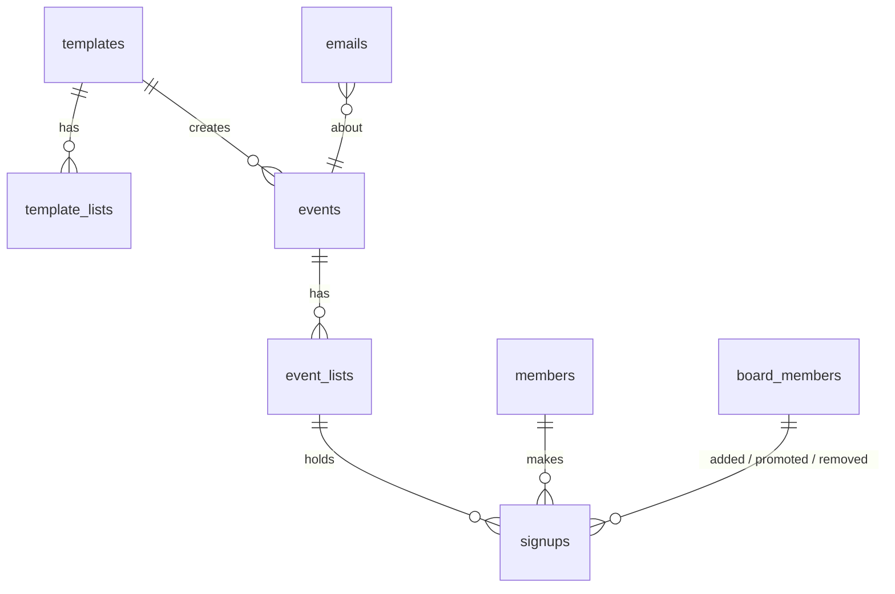

# CBS FC · The List: Data Model

_Last updated 2026-10-08, to match the built schema in `supabase/migrations`. Postgres on Supabase. See [PLAN.md](PLAN.md) for requirements and [SCREENS.md](SCREENS.md) for screens._

## Overview

| Table | What it is | UI name |
|---|---|---|
| `templates` + `template_lists` | A recurring practice and its lists | Weekly schedule |
| `events` + `event_lists` | One dated practice and its lists (copied from the template, then editable) | Practice |
| `members` | A person, matched by email | — |
| `signups` | One person's spot on one list: main or waitlist, plus team | The list |
| `board_members` | Who can log in to `/admin`, and their role | Board |
| `emails` | Outbox + log of every notification | — |

Everything is generic "events" with `type = 'practice'` for now, so games and socials can be added later without a redesign.

---

## Tables

### `board_members`
| Column | Type | Notes |
|---|---|---|
| id | uuid pk | |
| email | text unique not null | Lowercase (checked). Login is matched on this |
| user_id | uuid unique null → `auth.users` | Filled on first login |
| name | text | |
| role | enum `president` \| `board` | |
| invited_by | uuid null → board_members | |
| last_login_link_at | timestamptz null | Throttles login emails to one a minute |
| created_at | timestamptz | |

- Removing someone deletes the row. History columns elsewhere use `on delete set null`.
- **A trigger blocks deleting or demoting the last president.**

### `templates` (Weekly schedule)
| Column | Type | Notes |
|---|---|---|
| id | uuid pk | |
| type | enum `practice` | Room for `game`, `social` later |
| title | text | "Wednesday practice" |
| weekday | smallint 0–6 | |
| start_time, end_time | time | New York local time. Always the earliest list start and the latest list end |
| location | text | |
| open_mode | enum `auto` \| `manual` | |
| open_days_before | smallint default 1 | Auto mode: "the day before" |
| open_time | time default 09:00 | Auto mode, New York local |
| paused | boolean default false | No new events while paused |

### `template_lists`
`id`, `template_id`, `name` ("Skills"), `cap` (int, default 40), `makes_teams` (bool), `position` (display order), `start_time`, `end_time` (New York local; each list has its own time, e.g. Friday Skills 10–11 and Games 11–12. Filled from the template by trigger when left out).

### `events` (one practice)
| Column | Type | Notes |
|---|---|---|
| id | uuid pk | |
| template_id | uuid null → templates | Null for one-offs later |
| type, title, location | | Copied from the template |
| slug | text unique | `2026-10-08-wed`, used in URLs |
| starts_at, ends_at | timestamptz | Stored in UTC. Always the earliest list start and the latest list end |
| opens_at | timestamptz **null** | Null = manual and not opened yet. "Open sign-ups" sets it to `now()` |
| locks_at | timestamptz = `starts_at − 2h` | Kept by a trigger on insert and on every change to `starts_at` |
| edited_at | timestamptz null | Set when the board edits this practice. Template changes then skip it |
| cancelled_at, cancel_reason, cancelled_by | | |

- `unique (template_id, starts_at)` lets the daily cron run any number of times without creating duplicates.
- **Saving a template** (`apply_template`) rebuilds its future events that haven't opened, haven't been edited, and have no sign-ups. Pausing does the same, so paused weeks disappear from the home page.

### `event_lists`
`id`, `event_id`, `name`, `cap`, `makes_teams`, `position`, `starts_at`, `ends_at` (the list's own time, copied from `template_lists`; filled from the event by trigger when left out), `teams_sent_at` (null until **Send teams**).

- `edit_event(event, location, lists jsonb, notify)` sets each list's times; the practice's `starts_at`/`ends_at` (and so `locks_at`) follow its lists. The list locks 2 hours before the **first** list starts.

### `members`
| Column | Type | Notes |
|---|---|---|
| id | uuid pk | |
| email | text **unique, null**, lowercase | Null only for walk-ins added without one |
| name | text | **Latest wins**: every sign-up updates it |
| phone | text null | E.164 (`+12125550148`), checked with a constraint. Latest wins |
| last_signup_at | timestamptz | Drives the 12-month cleanup |

### `signups` (the heart of it)
| Column | Type | Notes |
|---|---|---|
| id | uuid pk | |
| list_id | uuid → event_lists | |
| member_id | uuid → members, **on delete cascade** | |
| spot | enum `main` \| `waitlist` | **Stored, not derived**: after the lock a drop must *not* move the waitlist up, so position alone can't decide |
| status | enum `active` \| `dropped` \| `removed` | |
| created_at | timestamptz | Waitlist order |
| promoted_at | timestamptz null | |
| promoted_by | uuid null → board_members | Null = automatic promotion |
| added_by | uuid null → board_members | Null = signed up themselves |
| dropped_at | timestamptz null | |
| dropped_late | boolean | Set at drop time (after `locks_at`). Stays true even if the practice is later rescheduled |
| removed_at, removed_by | | Board removed them |
| team | enum `black` \| `white` \| `red` \| `light_blue` null | Current assignment in the builder |
| team_sent | same enum, null | What we last emailed them. `team ≠ team_sent` → counted in **Send updates (n)** |

- `unique (list_id, member_id) where status = 'active'` gives **one spot per email per list**. Someone who dropped can sign up again and goes to the end.
- **Main list order:** `coalesce(promoted_at, created_at)`, so people promoted later appear at the bottom.
- **Waitlist order:** `created_at`. The first row is tagged "Next up".
- **Late drops page:** `where dropped_late`. No separate drops table is needed.

### Sign-up links (no table)
Each practice has its own link, `/p/<slug>?k=<key>`, where the key is an HMAC of the event id with `DROP_LINK_SECRET` (see `src/lib/signup-link.ts`).
- The board copies it (or a ready-made WhatsApp post) from the practice page and posts it in the group. The home page and a practice page without a valid key only say "Get the link in WhatsApp", so people outside the group can't see or join practices.
- The key stops working when the practice ends, so old links don't let anyone into later practices.
- Emails that point at the practice page ("See all teams") carry the key, so people who signed up can always get back.
- Rotating `DROP_LINK_SECRET` also invalidates every sign-up link already posted.

### Personal drop-out links (no table)
A link is `/drop/<event_id>.<member_id>.<signature>`, where the signature is an HMAC of the two ids with `DROP_LINK_SECRET` (see `src/lib/drop-link.ts`).
- Nothing is stored: the server can recompute and check the signature. The same person always gets the same link for a practice, so **every** email they get for it keeps working, and it opens the drop page for **all** their lists in that practice.
- The link is only handed to the browser when the sign-up created a new spot, so typing someone else's email can't be used to get their link.
- Rotating `DROP_LINK_SECRET` invalidates every link already emailed.

### `emails` (outbox + log)
| Column | Type | Notes |
|---|---|---|
| id | uuid pk | |
| channel | enum `email` | WhatsApp/SMS plug in here later |
| kind | enum | `signup`, `promoted`, `team`, `cancelled`, `changed`, `board_message`, `late_drop`, `board_invite` |
| to_address | text | |
| member_id, event_id | uuid null | |
| payload | jsonb | Everything the template needs to render |
| status | enum `pending` \| `sent` \| `failed` | |
| attempts, last_error, claimed_at, created_at, sent_at | | |

- Rows are written **in the same transaction** as the action that triggers them, so an email is never lost and never sent for something that rolled back.
- Right after the action, the server sends pending rows in the background using Next.js `after()`, so the member doesn't wait. A daily cron and a **Retry** button in admin pick up failures.
- Senders take rows with `claim_emails(n)` (`FOR UPDATE SKIP LOCKED`), so two senders never send the same email. A claim expires after 5 minutes, and a failed email is retried up to 5 times.
- A guard counts `sent` rows in the last 24 h against Gmail's ~500/day limit (it stops at 450).
- Login links are **not** in this table: they are secrets, so they are sent directly and never stored.

---

## Rules that live in the database

These are Postgres functions (called through Supabase `rpc`), so the rules hold no matter which screen calls them. Each one locks the affected `event_lists` rows with `SELECT … FOR UPDATE`, always in the same order, before counting.

| Function | What it does |
|---|---|
| `sign_up(event, lists[], name, email, phone)` | Checks the practice is open, not locked or cancelled. Upserts the member (latest wins). Per list: skips if already on it, otherwise `main` if the count is under the cap, else `waitlist`. Queues **one** combined email. |
| `drop_signups(event, member, lists[])` | Marks spots `dropped`. **Before the lock**, if a main spot opened, promotes the oldest waitlister and queues their email. **After the lock**, sets `dropped_late` and queues a heads-up to every board member. |
| `remove_signup(id, by)` | Same as a drop (promotes before the lock) but status `removed`, with no late flag. |
| `add_signup(list, name, email?, phone?, spot, by)` | Walk-ins. The board picks `main` (can exceed the cap) or `waitlist`. |
| `promote_signup(id, by)` | After the lock only: moves **any** waitlister to main. Before the lock it's automatic. |
| `set_list_cap(list, cap)` | Raising it before the lock promotes from the waitlist. Lowering it never removes anyone. |
| `open_event`, `cancel_event`, `edit_event`, `message_event` | Set the timestamps and queue the emails. |
| `shuffle_teams`, `set_team`, `send_teams` | Random even split; one move; email everyone whose `team ≠ team_sent` (first send = everyone, later = **Send updates**). |
| `create_upcoming_events(days)`, `apply_template`, `delete_template` | Build practices from the weekly schedule. Safe to run any number of times. |
| `claim_emails(n)`, `cleanup_inactive_members()` | Outbox and housekeeping, used by the daily job. |

Execute rights on all of these are revoked from the public roles: only the server (service role) can call them.

### Stage of a practice (computed, never stored)
Checked in order, with `now()`:
1. `cancelled_at` set → **Cancelled**
2. `now ≥ ends_at` → **Past**
3. any teams list has `teams_sent_at` → **Teams are out**
4. `now ≥ locks_at` → **Locked**
5. `opens_at` set and `now ≥ opens_at` → **Open** (each list is **Full** when main count ≥ cap)
6. otherwise → **Opens soon**, or **Waiting for the board** if `opens_at` is null

---

## Access & privacy

- **Row Level Security is on for every table, with no policies.** The public and logged-in Supabase roles can't read or write anything directly, even with the publishable key.
- All data access goes through the Next.js server with the secret key (`db()` in `src/lib/supabase.ts`). Each server action checks who is asking first:
  - Members: the email for sign-ups, the signed drop-out link for everything after.
  - Board: `requireBoard()` / `boardOnly()` / `presidentOnly()` in `src/lib/auth.ts` match the Supabase Auth session's email to `board_members` (and fill in `user_id` on first login). Removing a row locks that person out on their next request.
- The public list returns **names only**; emails and phones never leave the server except on board pages.
- The browser's "remember me" stores name, email, phone, and the personal links in `localStorage`. That's enough to show "You're in" and the drop button, and nothing anyone else can use.

## Board login

1. `/admin/login`: if the email is in `board_members` (and no link went out in the last 60 s), the server makes a magic link with `auth.admin.generateLink` (creating the auth user on first login) and sends it from the club Gmail. The page always gives the same answer.
2. The link opens `/admin/auth/confirm`, which logs in only when the person **presses the button** (`verifyOtp`), because email scanners open links automatically.
3. `src/proxy.ts` refreshes the session cookie on `/admin` pages.

## Daily job (Vercel cron, 10:00 UTC = 6 AM New York in summer, 5 AM in winter)

`GET /api/cron` with `Authorization: Bearer $CRON_SECRET`:
1. **Create events** for the next 14 days from unpaused templates. Weekday + local time are converted to UTC with `America/New_York`, so daylight saving is handled.
2. **Send** any emails still pending, and retry failed ones (up to 5 tries; after that the board sees a **Retry** button).
3. **Clean up members** with `last_signup_at` older than 12 months and no upcoming sign-ups. Their sign-ups and late-drop history are deleted with them. Email logs older than 90 days go too.

Running every day also counts as activity, so the free Supabase project doesn't pause.
